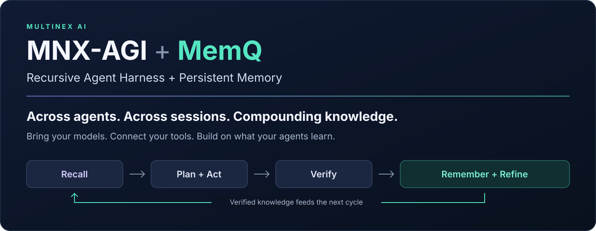

# MNX-AGI



[](https://github.com/multinex-ai/mnx-agi/releases)
[](LICENSE)
[](package.json)
[](https://multinex.ai/memq/)
[](https://github.com/multinex-ai/mnx-agi/actions/workflows/validate.yml)

**[First-run setup](docs/FIRST_RUN.md) · [Installation and recovery](docs/INSTALL.md) · [Pair with MemQ](docs/MEMQ_PAIRING.md) · [Public scope](docs/PUBLIC_SCOPE.md)**

## Recursive Agent Harness + MemQ

**Across agents. Across sessions. Build on verified work.**

MNX-AGI gives compatible agents a common way to plan, act, verify and resume. It installs a small Accord, focused skills and local configuration tools. Pair it with an authenticated [MemQ](https://multinex.ai/memq/) connection to retain selected decisions, evidence and task checkpoints across authorized sessions.

Bring your models and use the supported hosts you already work in. The public harness supplies operating guidance and testable integration boundaries; MemQ supplies persistent memory. Installation alone does not connect every AI app, grant access to another project, or establish general intelligence.

## Install and configure on first run

Requires Node.js 22 or later on macOS or Linux. No runtime npm dependencies, model key or administrator password is needed for the default instruction/skill installation. Obtain a reviewed archive and its checksum from [GitHub Releases](https://github.com/multinex-ai/mnx-agi/releases), or use a reviewed source checkout.

The source candidate includes the setup flow below. Stable v1.3.0 uses the compatible `init` command in the [version-pinned quickstart](docs/QUICKSTART.md). Use a release that includes `setup` before running these commands:

```sh
node bin/mnx-agi.mjs verify-package
node bin/mnx-agi.mjs setup --global --hosts codex,claude --dry-run
# Read constitution/CORE.md and the selected profile before adoption:
node bin/mnx-agi.mjs setup --global --hosts codex,claude --accept-accord
node bin/mnx-agi.mjs doctor --global
```

Setup previews without writing until adoption is explicit. It records the exact core digest and local preferences in private `.mnx-agi/accord.json`, preserves existing instructions outside its managed block, and keeps recovery snapshots locally. Select one host with `--hosts codex` or `--hosts claude`. Start a fresh host session to load the new guidance.

[Configure your profile and memory references](docs/FIRST_RUN.md), including local-only defaults, an optional Rust/TypeScript preference, excluded-project policy references, changed-policy review, and explicit configuration replacement. Project realm policies and actual host permissions remain authoritative.

## What is installed

| Component | Purpose |
|---|---|
| [Common Accord](constitution/CORE.md) | A bounded work lifecycle, evidence requirements and ownership boundaries |
| [Twelve focused skills](docs/SKILLS.md) | Recall, compact checkpoints, coordination, learning, ingestion, operations and maintenance workflows |
| Private local configuration | Profile, selected core adoption, memory references and project exclusions |
| Realm schema and offline validator | Check declared structure and consistency without granting remote access |
| Install, upgrade, doctor and rollback tools | Reversible local file changes, conflict checks and package integrity |
| [Runtime contract](docs/RUNTIME.md) | Scope, authorization and receipt requirements for an explicitly integrated host adapter |

For a project, omit `--global` and use `--dir /path/to/project`. Custom host homes require the integration described in [installation and recovery](docs/INSTALL.md). Filesystem installation does not install this package into ChatGPT cloud chats or retroactively update running sessions.

## How the MemQ pairing works

1. Configure the intended MemQ connection in the actual host using its supported OAuth sign-in.
2. Resolve the active project and verify the returned service, principal, namespace and project binding.
3. Retrieve only the context needed for the next action; verify the result of the work.
4. Save one concise checkpoint with evidence and current artifact revisions, then read it back.
5. In a new authorized session or compatible host, repeat identity checks and resume from that checkpoint.

Each verified cycle supplies useful context to the next. That is the recursive loop: bounded feedback and reuse, with explicit permission boundaries and stopping conditions. Knowledge reuse can improve continuity; measured performance improvement requires evaluation.

The [compact-memory workflow](docs/COMPACT_MEMORY.md) limits repeated context and supports version reuse. The evaluation target is 30% fewer whole-task AI tokens and 30% lower combined AI/memory cost without reducing correctness, recovery or isolation. **That target is not a measured result.**

## Enforcement is a separate integration

The default installer makes instructions and skills available. It does not issue credentials, enforce remote ACLs, provide exclusive task ownership or configure federation. `doctor` distinguishes local adoption from unverified memory and enforcement.

The [experimental macOS broker and isolated-host installer](docs/ISOLATED_HOSTS.md) can separate credentials from a dedicated agent identity. Enrollment, host authentication and live acceptance remain separate steps. Those launchers cover their process trees; ordinary desktop apps, other CLI launches and cloud agents are outside that boundary. Review [managed host acceptance](docs/MANAGED_HOST_ENFORCEMENT.md) before activating policies.

Keep customer identities, real namespaces, founder bindings, transcripts, internal roadmaps and product extensions private. This public repository contains the harness and supported integration contracts. [Disclosure checks](docs/PUBLIC_SCOPE.md) supplement manual review; cleaning the current tree does not retract previously published history.

## Guides and verification

| Guide | Use it for |
|---|---|
| [First run](docs/FIRST_RUN.md) | Review and adopt the Accord, configure private preferences |
| [Install and recovery](docs/INSTALL.md) | Host paths, upgrades, conflicts and rollback |
| [MemQ pairing](docs/MEMQ_PAIRING.md) | Scoped continuity across sessions and compatible hosts |
| [MemQ contract](docs/MEMQ_CONTRACT.md) | Identity, capabilities and privacy requirements |
| [Compact memory](docs/COMPACT_MEMORY.md) | Bounded checkpoints and honest efficiency measurement |
| [Acceptance](docs/ACCEPTANCE.md) | Evidence required before broadening adoption |
| [Public scope](docs/PUBLIC_SCOPE.md) | What belongs in releases and what remains private |

```sh
npm test
npm run test:broker
npm run check
```

After an intentional source change, synchronize skill references and rebuild the manifest. Release archives must come from the exact reviewed commit. Checksums detect drift and depend on a trusted distribution channel; they are not signatures.

Licensed under [Apache-2.0](LICENSE). [Security reporting](SECURITY.md) · [Release process](docs/RELEASE.md).
