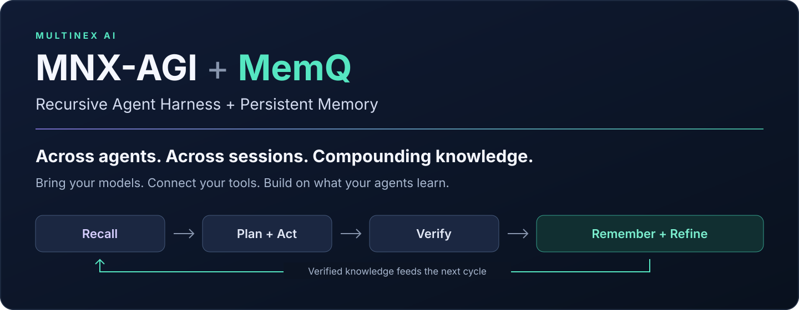
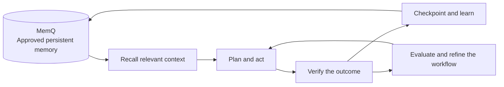

# MNX-AGI



[](https://github.com/multinex-ai/mnx-agi/releases)
[](LICENSE)
[](package.json)
[](https://multinex.ai/memq/)
[](https://github.com/multinex-ai/mnx-agi/actions/workflows/validate.yml)

**[Install the harness](#install) · [Connect memory](docs/QUICKSTART.md) · [Explore the pairing](docs/MEMQ_PAIRING.md) · [Review the evidence](docs/ACCEPTANCE.md)**

## Recursive Agent Harness + MemQ

**Across agents. Across sessions. Compounding knowledge.**

Make useful work compound. MNX-AGI is a model-agnostic **Recursive Agent Harness**, paired with **[MemQ](https://multinex.ai/memq/)** for persistent memory. It gives supported AI agents a shared way to plan, act, verify, remember, and improve—so the next task, session, or authorized agent can build on what is already known.

**Bring your models. Connect your tools. Build on what your agents learn.**

**Reusable agent infrastructure for coordinated work and lasting memory.** Adopt MNX-AGI in the agent hosts and applications you already use. Carry objectives, verified decisions, progress, and reusable procedures across supported models and authorized sessions through MemQ.

MNX-AGI supplies the operating rules, focused skills, realm boundaries, and evaluation loop. MemQ supplies durable context through a configured memory connection. Together, they are designed to make continuity feel seamless across compatible agents while keeping each project's access and ownership explicit.

- **Remember across sessions.** Retain selected decisions, preferences, verified procedures, and progress checkpoints instead of rebuilding context each time.
- **Continue across agents.** Let another authorized agent retrieve the same approved knowledge and resume from current artifacts and handoff evidence.
- **Make knowledge compound.** Reuse a verified lesson, test it against new work, and refine it with fresh evidence. Retained knowledge can accumulate value over time.
- **Keep your choice of model and tools.** Adopt the harness in supported hosts and connect additional agents through the published adapter contracts.
- **Bridge supported embedding formats.** MemQ's universal vector-translation interfaces support dimension adaptation within a shared memory workflow. Preserve source-backed knowledge as your stack evolves; validate retrieval quality for each embedding profile. [Understand vector translation](docs/VECTOR_TRANSLATION.md).

### What this changes for you

| When you… | The benefit |
|---|---|
| Open a new session | Retrieve saved decisions and next steps instead of rebuilding the brief |
| Change agents or tools | Carry approved context into another compatible, connected host |
| Find a fix that works | Retain the verified procedure so future work can start from it |
| Evolve your model stack | Keep source-backed knowledge portable and evaluate supported vector translation for the new embedding profile |
| Hand work to a teammate | Share an authorized checkpoint with evidence, open questions, and ownership |

### What makes it recursive?

The output of one verified work cycle becomes useful input to a later cycle:



Recursion here means bounded feedback and reuse. Each cycle keeps an objective, acceptance criteria, permission boundaries, and stopping conditions. Changes to skills or policy are reviewed and evaluated before adoption. Compounding refers to reusable knowledge and better continuity; measured performance gains require behavioral evaluation.

Explore the [MNX-AGI + MemQ pairing](docs/MEMQ_PAIRING.md), [reusable infrastructure modules](docs/HARNESS_MODULES.md), [eleven workflow skills](docs/SKILLS.md), and [architecture](docs/ARCHITECTURE.md).

### Compatibility and readiness

| Surface | What is available |
|---|---|
| Codex and Claude Code | Reversible installation of core instructions and eleven self-contained skills |
| MemQ | Recall, checkpoint, learning, and handoff workflows; a configured connection and verified account scope are required |
| Universal vector translation | MemQ-side dimension-adaptation interfaces; supported profiles and retrieval quality require deployment-specific validation |
| Other models and agent hosts | Model-agnostic rules and adapter contracts; host integration and acceptance testing are required |
| Isolated credential broker | Experimental macOS service installer and fixed-identity plan interface; separate enrollment and host containment remain required |
| Guarded Codex-to-MemQ route | Experimental adapter for isolated plan reads and conditional writes, with a live acceptance probe |
| Team coordination and federation | Explicit contracts and acceptance gates; deployment requires verified ownership, grants, and service controls |

Cross-agent continuity applies to compatible, configured agents authorized for the same knowledge. Installing the package does not connect every AI app automatically. MNX-AGI is the product name; the package makes no claim of general intelligence or automatic model training.

## Install

Requires Node.js 22 or later on macOS or Linux. Download a tagged archive and its `SHA256SUMS` from [GitHub Releases](https://github.com/multinex-ai/mnx-agi/releases), verify the archive checksum, extract it, then run the following commands from the extracted directory. The [step-by-step quickstart](docs/QUICKSTART.md) includes download, verification, connection, and recovery instructions.

```sh
node bin/mnx-agi.mjs verify-package
node bin/mnx-agi.mjs init --global --hosts codex,claude --dry-run
node bin/mnx-agi.mjs init --global --hosts codex,claude
node bin/mnx-agi.mjs doctor --global
```

Existing instructions are preserved outside a clearly marked managed block. Eleven self-contained skills are installed for each selected host. The executable is placed at `~/.local/bin/mnx-agi`; use that path directly if it is not on your PATH. Start a new host session to load the updated global instructions. Skills are available when the host next refreshes its skill inventory.

Install only the hosts you use: choose `--hosts codex`, `--hosts claude`, or both. A successful installation makes the harness guidance available. Connect MemQ separately, verify the intended account and namespace, and complete a bounded read/write acceptance check before relying on persistent memory. The default `doctor` command checks the local installation; it does not test the remote connection.

For a project, run `node bin/mnx-agi.mjs init --dir /path/to/project`. This installs AGENTS.md guidance, skills and a customizable local-only `.realm` configuration. Review and ignore private project state before committing it. See [installation and recovery](docs/INSTALL.md).

## What is included

| Component | Status |
|---|---|
| [Core constitution](constitution/CORE.md) and optional profiles | Adoptable instructions, embedded in host instruction files |
| [Eleven skills](docs/SKILLS.md) | Installed self-contained workflows; no automatic network activity |
| [Realm schema](schemas/realm.schema.json), examples and validator | Offline structure and consistency validation |
| Installation, upgrade, verification and rollback CLI | Local files, conflict detection, backups and integrity manifest |
| [Memory contract](docs/MEMQ_CONTRACT.md) | Capability and identity requirements for a connected service |
| [MemQ pairing guide](docs/MEMQ_PAIRING.md) | Cross-session continuity, cross-agent reuse, and the recursive learning loop |
| [Federation architecture](docs/ARCHITECTURE.md) | Integration contract; requires an external gateway and authorization |
| [Research](docs/RESEARCH.md) and [acceptance criteria](docs/ACCEPTANCE.md) | Primary-source rationale and explicit implementation boundaries |

The default installer provides instructions, skills, and local validation. Authentication, host enforcement, distributed ownership, and federation are deployment responsibilities. `runtimeVerified: false` remains the default until the actual integration is verified. Host permissions and service-side controls remain authoritative; private account mappings stay outside this public package.

## Adaptive memory planning

Use `node bin/mnx-agi.mjs memory-plan examples/memory-plan.json` to produce a bounded candidate workflow from available capability declarations and task signals. Read [adaptive memory workflows](docs/MEMORY_WORKFLOWS.md) for retrieval stopping rules, evidence quality and evaluation. The planner is offline and advisory; it does not authenticate or call MemQ.

## Opt-in runtime integration and evaluation

The [runtime boundary](docs/RUNTIME.md) checks current scope, policy, capability gates and operation receipts for calls routed through a trusted host adapter. It includes bounded search-visibility polling and paired evaluation scoring. It is not automatically wired into host tools, and synthetic contract tests do not prove live federation or model performance.

The experimental [MemQ host integration candidate](docs/MEMQ_ENFORCEMENT_CANDIDATE.md) adds a narrow stdio gateway and a live Codex-host acceptance probe. It is separately configured and does not establish a sealed system installation or change the default installer's enforcement status.

[Managed host enforcement](docs/MANAGED_HOST_ENFORCEMENT.md) describes the prepared Codex/Claude policies, independent account tests, and the credential-broker and OS boundaries required before activation. Policy generation alone is not enforcement.

## Develop and verify

```sh
npm test
npm run check
node bin/mnx-agi.mjs validate examples/local.realm.json
```

There are no runtime npm dependencies. After an intentional source change, run `node tools/build-skills.mjs` and `npm run manifest`, review the changed hashes, and rerun the checks. A matching manifest detects drift; its trust depends on obtaining the release through a trusted channel. It is not a cryptographic signature.

Licensed under [Apache-2.0](LICENSE). Security reporting and scope: [SECURITY.md](SECURITY.md). Release procedures: [docs/RELEASE.md](docs/RELEASE.md).
