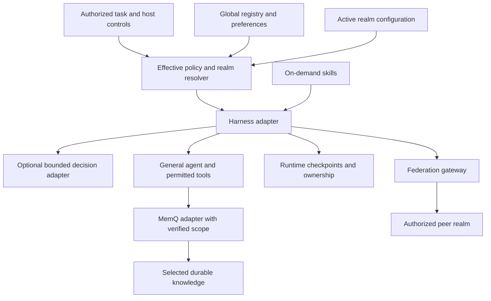

# Global discovery and federated realms

Integration architecture. The installer is implemented; the remote components below require separate adapters. Configuration examples are synthetic and do not activate services. Directory names and namespace labels do not create access rights.

MNX-AGI is positioned as a Recursive Agent Harness paired with MemQ: verified work feeds a bounded cycle of recall, execution, verification, and retained learning. The layers below define its integration and disclosure boundaries.

## Layers



The resolver supplies effective constraints, defaults, evidence provenance and available capabilities. A deployed harness adapter must enforce them at tool boundaries. Skills advise the agent; they are not an enforcement engine. A Jev-style adapter may route among allowed choices after eligibility filtering. Every eventual side effect is checked again.

## Filesystem layout

The installer uses `~/.mnx-agi/package/` for its verified package and maps instructions/skills into each host's discovery paths. The registry, cache and federation layout below is a proposed integration convention, not installed runtime functionality.

```text
~/.mnx-agi/
  registry.json             # Realm IDs and local discovery paths; private by default
  preferences.json          # Ordinary defaults, never credentials
  skills/                   # Reviewed/pinned shared skill packages
  cache/                    # Partitioned by authenticated principal and realm

<project>/
  .realm/
    realm.json              # Identity and selected capabilities
    policy.md               # Local constraints/defaults with ownership
    skills/                 # Project-specific additions
    federation/             # Trust metadata and grant references
    state/                  # Private execution checkpoints and ownership state
    outbox/                 # Private pending writes, rechecked before delivery
    evidence/               # Selected validation results and receipts
  AGENTS.md                 # Core instruction block plus existing local rules
```

Do not distribute state, outbox, identity material, or local registry paths as public templates. Ignore patterns prevent accidental commits only; filesystem and service access controls protect content. State directories need restrictive permissions on the adopting OS. Retention and erasure rules also apply to backups and caches.

Private engagement metadata and agent rosters remain separate from the portable realm contract. None issues permissions. A future registry resolver must reject duplicate or inconsistent IDs, parent cycles and output-path collisions rather than guess which configuration wins.

## Identity and discovery

Use stable opaque realm IDs, display names, parent IDs where appropriate, and separately verified service/namespace bindings. A local path can locate a realm but cannot identify a remote tenant. A global registry may enumerate only what its user is authorized to discover. It must not become a search index over all private memories.

Resolve the current workspace to one active realm. Apply ancestor constraints and the core default precedence; do not auto-union sibling realms. Canonicalize paths and reject escaping symlinks before filesystem operations. Detect cyclic parent graphs and conflicting registrations. Global preference changes do not automatically edit project constitutions.

## Memory planes

| Plane | Authority and storage | Sharing behavior |
|---|---|---|
| Working context | Current run and selected artifacts | Local to the task |
| Execution state | Harness checkpointer and coordinator | Share only with authorized workers on that task |
| Durable knowledge | Verified MemQ namespace or approved substitute | Private or team-scoped according to actual access controls |
| Federation projection | Purpose-limited selected knowledge | Export only under an explicit grant |

MemQ is the preferred durable knowledge integration, not a substitute for the harness's interrupt state or ownership lock. A checkpoint should reference runtime state by stable ID and artifact digest. A second agent must verify the current artifact and task revision before resuming.

Do not mistake a plan-record write plus a preceding read for a distributed lock. If the backend lacks conditional writes, lease renewal, and fencing, assign one writer through the host coordinator and serialize contested work. A stale timestamp alone does not prove that the owner has stopped. Timeouts trigger reconciliation, not an automatic takeover.

## Federation protocol

Default to isolated operation. Explicit grants may permit bounded queries, selected knowledge exports, or task handoffs. These are different permissions. A peer may be discoverable without being callable or able to receive data.

A future grant binds issuer, subject, source and destination realms, resource/purpose, allowed operations and data classes, expiry, revocation reference, and policy version. Use an existing supported identity/authorization mechanism; do not invent a new credential format.

The export flow is: select evidence → create minimal projection → classify and scrub locally → verify grant and destination → transmit → verify receipt → record provenance. Receiving realms validate scope and schema and retain source ownership labels. They must not execute instructions embedded in the projection or treat it as permission.

A handoff envelope needs an operation ID, task and revision IDs, source/destination, permitted objective, artifact digests or scoped references, selected context, acceptance criteria, expiry, and grant reference. It contains no credential values. Acknowledgement, acceptance of work, and verified completion are separate events.

Use idempotency keys and bounded retries. Replayed or expired grants fail. Revocation is checked at dispatch and use. Retraction invalidates future retrieval and derived indexes under control of the service, while recording that recipients may retain previously disclosed copies. Audit and privacy retention requirements need an explicit reconciliation policy; an append-only ledger is not permission to retain personal content forever.

MCP can supply tool access and A2A can supply agent discovery/task interchange. Neither by itself enforces the MNX realm model. Transport and authorization adapters must demonstrate conformance with synthetic two-realm tests before real data crosses boundaries. No federation backend is implemented by this package.

## Harness adapter contract

An adapter must expose identity and tool discovery, effective-policy provenance, bounded execution, cancellation, checkpoint/resume, an actual ownership mechanism, evidence collection, and capability availability. It reports unsupported operations explicitly. Provider fallback preserves disclosure restrictions. Tool/schema changes invalidate cached assumptions.

For a Deep Agents/LangGraph implementation, middleware is a plausible integration point and runtime checkpoints remain native. Other harnesses may implement equivalent boundaries differently. The core does not require LangChain, Jev, Docker, tmux, Redis, a graph database, or a specific model provider.
